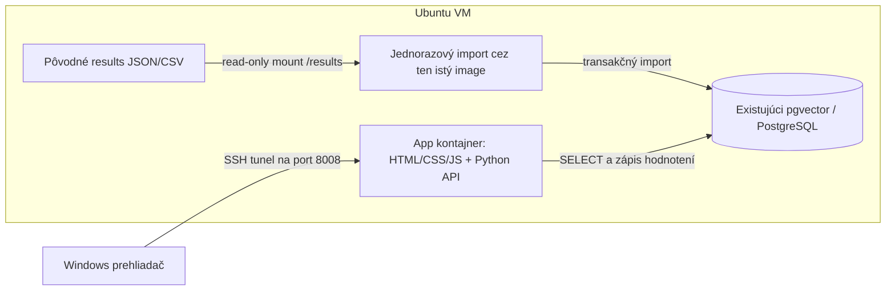
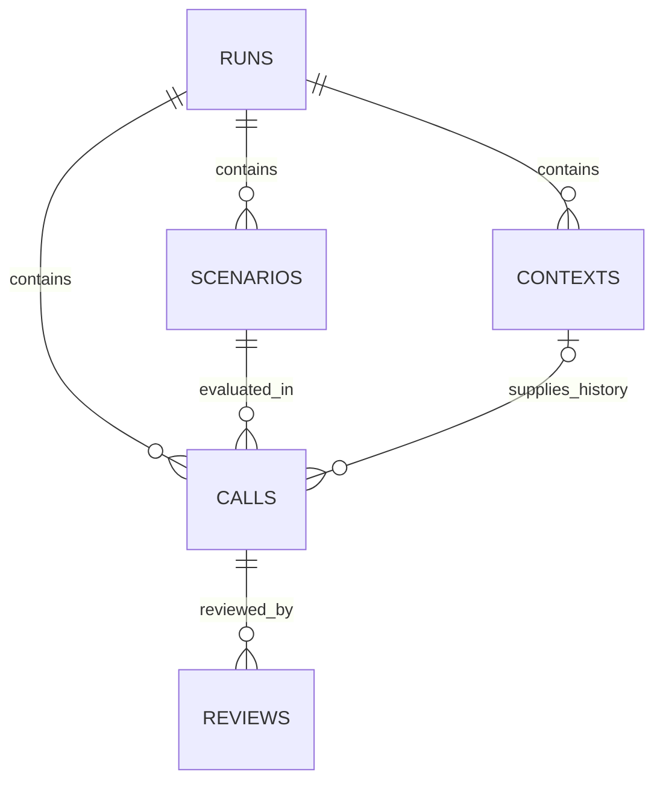
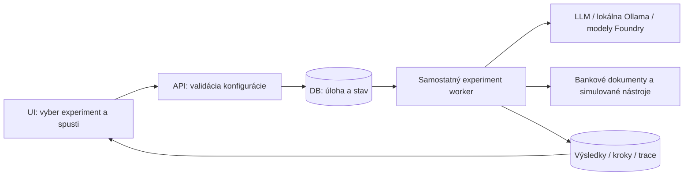

# LLM Homelab — aplikácia, databáza a cesta k testovaniu bankového agenta

**Stav k 1. novembru 2026.** Dokument opisuje aktuálne implementovanú aplikáciu
v [app_llm_homelab](app_llm_homelab/) a návrh jej ďalšieho využitia.
Časti označené **plán** zatiaľ nie sú implementované.
Aplikácia je lokálny nástroj domáceho labu, nie produkčná banková platforma.

## 1. Na čo aplikácia slúži dnes

LLM Homelab spája výsledky experimentov do jedného rozhrania:
výkon, tokeny, odhadované náklady, spoľahlivosť a ručné hodnotenie odpovedí.

Pôvodný use case: nový syntetický SAP HANA/Oracle incident → retrieval historických
incidentov → LLM navrhne najviac tri investigatívne kroky. Porovnávame viac LLM
nad viacerými embedding profilmi a kontrolný beh bez histórie.

Aplikácia dnes vie:

- načítať priečinky JSON/CSV priamo v prehliadači;
- načítať importované výsledky z PostgreSQL cez lokálne API;
- spojiť manifest, scenáre, kontexty, odpovede a hodnotenia;
- filtrovať beh, LLM, embedding profil, režim a identifikátor scenára;
- zobrazovať úspešnosť, latencie, tokeny, ceny a prieskumnú koreláciu;
- porovnať RAG a no-history beh;
- zobraziť aktuálny incident, review guidance, prompt, históriu a odpoveď;
- uložiť ručné hodnotenie lokálne alebo do DB podľa aktívneho režimu;
- exportovať vybrané výsledky a hodnotenia do CSV.

**Dnes z rozhrania nespúšťa benchmark, model ani agenta.** Importuje už vzniknuté
výsledky a umožňuje ich vyhodnocovať. Tlačidlo Načítať z PostgreSQL iba číta DB.
Demo obsahuje syntetické ukážky; nepovažovať ho za výsledok experimentu.

## 2. Kde sa čo nachádza

```text
ai-labs/
├── APP-LLM-HOMELAB.md            tento dokument
├── code/                       SAP/Oracle runner a pôvodné výsledky
│   └── results/
│       ├── rag-dev-.../
│       ├── no-history-dev-.../
│       └── rag-smoke-.../
├── code_banka/                 pripravovaný covenant-monitoring lab
└── app_llm_homelab/
    ├── index.html              rozloženie obrazoviek
    ├── styles.css              tmavý responzívny vzhľad
    ├── app.mjs                 obrazovky, filtre, grafy, hodnotiaci formulár
    ├── data.mjs                import CSV/JSON, deduplikácia a štatistiky
    ├── server.mjs              jednoduchý statický Node server, bez DB API
    ├── api_server.py           statické súbory + HTTP API pre PostgreSQL
    ├── db_store.py             DB pripojenie, import, export datasetu, hodnotenia
    ├── db_import.py            CLI importér, dry run alebo skutočný zápis
    ├── schema.sql              schéma llm_eval
    ├── Dockerfile              image rozhrania a Python API
    ├── compose.yaml            prevádzka app kontajnera
    ├── docker_lab.sh           príprava siete a obal nad Docker Compose
    ├── requirements.txt        závislosti Python backendu
    ├── .env.example            vzor konfigurácie; bez skutočného hesla
    ├── .dockerignore           vylúčenie lokálnych citlivých/pracovných súborov
    ├── data.test.mjs            dátové JavaScript testy
    ├── test_database.py        offline Python testy importu a validácie
    ├── README.md              základný návod a súborový režim
    ├── DATABASE.md            detail DB importu a priameho Python spustenia
    └── DOCKER.md              odporúčaný postup cez Docker
```

Samostatný priečinok umožňuje rozvíjať aplikáciu bez úpravy už meraného runnera.
Existujúce benchmarky sa počas behu nemenia len kvôli zmene dashboardu.

## 3. Architektúra Docker nasadenia



### Rozhranie

HTML, CSS a JavaScript bez frontend frameworku a bez závislosti na CDN.
Grafy vytvára vlastný SVG kód; nie je potrebné inštalovať grafovú knižnicu.
Dáta z odpovedí sa zobrazujú ako text; nie ako vykonateľný HTML obsah.
Rozhranie nemá prístup k DB heslu.

### Backend

Python štandardná knižnica HTTP servera, psycopg a python-dotenv.
API poskytuje len konkrétne čítacie operácie a zápis hodnotení.
Nemá endpoint na vykonanie ľubovoľného SQL, shell príkazu alebo modelového volania.

### Databáza

Používa existujúci PostgreSQL kontajner pgvector.
Evaluačné tabuľky sú v samostatnej schéme **llm_eval**.
Tabuľky incident_memory_* zostávajú zdrojom retrievalu a import ich nemení.
Samotné výsledkové tabuľky nepoužívajú vektorový typ ani vektorové vyhľadávanie.

### Docker a sieť

- Image: `llm-homelab:local`; vytvára sa lokálnym buildom.
- Kontajner zahŕňa rozhranie aj Python API; Node nie je potrebný v runtime image.
- API v kontajneri počúva na 0.0.0.0:8008.
- Na VM sa publikuje len 127.0.0.1:8008; používateľ pristupuje cez SSH tunel.
- Externá Docker sieť `llm-homelab` spája app s existujúcim `pgvector`.
- Helper pripojí DB kontajner aj do tejto siete; jeho pôvodnú sieť a volume nemení.
- App filesystem a results mount sú read-only; zapisovateľný dočasný priestor je /tmp.
- UID/GID sa cez helper prispôsobí používateľovi, aby mohol čítať jeho výsledky.
- Cloudové API kľúče sa do app kontajnera neposielajú.
- Healthcheck volá /api/health; samotný Up stav nenahrádza kontrolu DB.

## 4. Dva režimy práce s dátami

| Oblasť | Súborový režim | PostgreSQL režim |
| --- | --- | --- |
| Zdroj | ručne vybrané priečinky/súbory | importované dáta v llm_eval |
| Úplné prompty | ak sú v calls JSON | uložené v calls.data |
| Scenáre a guidance | manifest alebo review packet | manifest/scenarios v DB |
| Hodnotenia | localStorage prehliadača | reviews v DB cez API |
| Prístup z iného počítača | výsledky treba znova vybrať | DB načítanie cez aplikáciu |
| VM súbory | výber vo Windows ich priamo nevidí | API číta DB na VM |
| Spúšťanie experimentov | nepodporované | zatiaľ nepodporované |

V súborovom režime sa raw výsledky automaticky neukladajú do localStorage;
po obnovení stránky ich znovu importuješ. Lokálne skóre zostáva v danom prehliadači.

V DB režime je zdrojom skóre databáza. Lokálne skóre sa automaticky neprenáša do DB
a nemá prednosť pred DB hodnotením. Prenos je možný cez export quality_review.csv
k správnemu behu a následný import, ak DB hodnotenie ešte neexistuje.

## 5. Tok výsledkov od experimentu k dashboardu

1. Runner vytvorí priečinok behu a manifest nastavení.
2. Retrieval kontext sa uloží raz pre príslušný scenár/embedding.
3. Každé volanie má samostatný JSON výsledok vrátane neúspechu.
4. Runner vytvorí results.csv, summary.json a prázdny quality_review.csv.
5. Importér overí plné artefakty bez DB zápisu — dry run.
6. S --execute vytvorí schému, ak chýba, a transakčne importuje dáta.
7. Používateľ v aplikácii zvolí Načítať z PostgreSQL.
8. API vráti výsledky s DB identitou; frontend ich normalizuje rovnakým importným motorom.
9. Ručné skóre sa zapisuje cez POST /api/reviews.
10. Pri obnovení a opätovnom načítaní DB sa hodnotenie vráti.

Pôvodné exporty zostávajú auditným zdrojom. Databáza ani import ich neprepisujú.

### Náš prvý import

Potvrdený používateľským výstupom 1.11.2026:

| Beh | Volania | Kontexty |
| --- | ---: | ---: |
| rag-dev-2026-10-31-v2 | 480 | 48 |
| no-history-dev-2026-11-01 | 60 | 0 |
| rag-smoke-2026-10-31-v2 | 10 | 1 |
| Spolu | 550 | 49 |

Import vypísal inserted_calls=550, updated_pending_calls=0, unchanged_calls=0,
imported_reviews=0. V hlavnom RAG behu bolo 476 ok a 4 error:
tri 504 a jeden 429, všetky pri Argone.
Tabuľka počtov no-history nehovorí sama osebe nič o správnosti jeho odpovedí.

Smoke výsledky nezmiešavať s hlavným hodnotením. Filtruj príslušný beh.

## 6. Databázový model



| Tabuľka | Kľúč | Dôležité polia a účel |
| --- | --- | --- |
| runs | id UUID | fingerprint, created_at, name, manifest JSONB, imported_at |
| scenarios | run_id + scenario_id | úplný scenár v data JSONB |
| contexts | run_id + context_key | úplný retrieval záznam v data JSONB |
| calls | run_id + call_id | scenario_id, context_key, profily, mode, status, úplné data JSONB |
| reviews | run_id + call_id + reviewer | skóre/poznámky v data JSONB, updated_at |
| schema_version | version | aktuálne podporovaná verzia 1 |

UUID behu sa deterministicky odvodzuje z fingerprint + created_at.
Názov priečinka nie je jediná identita: premenovanie/kópia rovnakého behu nemá vytvárať
duplicitné volania. Dva nezávislé behy s rovnakou konfiguráciou a iným created_at
zostávajú oddelené.

Primárny kľúč calls je run_id + call_id. Rovnaké call_id môže existovať v dvoch
samostatných behoch. Opravný pokus sa nesmie potichu zameniť s pôvodným neúspechom.

### Prečo aj JSONB

Zachováva úplný prompt, odpoveď, raw usage, nastavenia a dodatočné metriky bez
straty pôvodného formátu. Relačné stĺpce slúžia na väzby a základné filtrovanie.

To nie je automatický agentový dátový model: uloženie nového poľa do JSONB ešte
neznamená, že ho dashboard interpretuje, zobrazuje alebo správne agreguje.

### Pravidlá opakovaného importu

- Rovnaký manifest a výsledok: bez novej kópie.
- Existujúci pending môže byť doplnený výsledným záznamom, ak sa nezmenila jeho identita.
- Iný obsah už dokončeného volania: import sa odmietne.
- Zmenený manifest alebo kontext pod identitou existujúceho behu: import sa odmietne.
- Zápisy pre celý import sú v jednej transakcii; konflikt ju vráti späť.
- Vyplnené CSV hodnotenie sa pridá iba ak pre dané volanie/hodnotiteľa ešte neexistuje.
- Existujúce DB skóre sa neprepisuje starším CSV.
- Chýbajúci kontext zostane bez väzby; aplikácia ho nevymyslí.
- Prázdna cena zostáva neznáma, nie nula.

Importer pre DB očakáva manifest + calls JSON, nie len osamotený results.csv.
Súborový frontend naopak vie pracovať aj s CSV, s upozornením na chýbajúce metadáta.

## 7. Obrazovky aplikácie

### Prehľad

- počet načítaných volaní, počet ok a ostatných stavov;
- úspešnosť API, nie automatická diagnostická správnosť;
- súčet známych odhadovaných LLM cien a počet neznámych cien;
- vykázané tokeny a počet volaní s neúplným usage;
- p50 a p95 latencie podľa modelu;
- známe náklady podľa modelu;
- bodový graf výstupné tokeny × čas, Pearson r a počet bodov;
- spoľahlivosť a priemerné úplné ručné skóre podľa modelu;
- tabuľka najviac 100 výsledkov aktuálneho výberu, s prechodom na hodnotenie.

p50/p95 sú počítané z úspešných odpovedí metódou nearest rank.
Technické chyby majú vlastný počet; nevstupujú ako nulová latencia.
Cena môže byť vykázaná aj pri neúplnej odpovedi, ak ju zdrojový výsledok obsahuje.

### RAG vs. bez RAG

Vyberáš konkrétny RAG beh a kontrolný no-history beh.
Aplikácia kontroluje vybrané nastavenia manifestov a scenáre; pri rozdieloch upozorní.
Nie je to dôkaz plnej zhody hardvéru alebo nemenenej cloudovej verzie.

Párovanie: scenario_id + llm_profile, v rámci dvoch vybraných behov.
Zobrazí priemernú latenciu dostupných úspešných RAG výsledkov a kontrolných výsledkov,
počet pozorovaní a priemerné ručné skóre, ak existuje.
Jednu kontrolnú odpoveď nepočíta osemkrát ako osem nezávislých meraní.

Globálny filter behu a režimu sa na tejto obrazovke nepoužíva — rozhodujú dva
vybrané behy. Filter modelu a embeddingu sa používa; kontrola zostáva bez embeddingu.
Porovnanie priemerov za viac embeddingov môže zakryť rozdiely jednotlivých profilov;
pre konkrétny profil použi embedding filter.

### Hodnotenie odpovedí

Zobrazí aktuálny incident, review guidance, odpoveď a rozbaliteľný prompt/históriu.
Review guidance je podklad pre hodnotiteľa a nedostáva sa do pôvodného modelového promptu.

Kritériá 0–2:
relevantnosť, práca s dôkazmi, správnosť citácií, neistota a použiteľnosť krokov.
Prázdne pole nie je nula. Súčet 0–10 sa počíta až po vyplnení všetkých piatich kritérií.
Kritická chyba yes/no a poznámka sa evidujú osobitne.

Skrytá identita odstráni názov modelu a cenu z detailu a zoznamu.
Nejde o formálne randomizované slepé hodnotenie: identita môže byť odhadnuteľná
z filtrov, poradia alebo vlastného textu odpovede.
Technické zlyhanie nehodnotiť automaticky nulovou diagnostickou kvalitou.
Pri no-history režime nepenalizovať absenciu historickej citácie.

### Behy a diagnostika

Prehľad počtov, chýb, cien, nastavení manifestu, uložených kontextov a importných upozornení.
Pôvodný názov behu zostáva viditeľný aj keď ho API prenáša pod DB UUID.

## 8. Cena, výkon a interpretácia

- llm_latency_s zahŕňa SDK inicializáciu, sieť, čakanie aj generovanie.
- load_duration_s a generation_tokens_per_second sú dostupné pri Ollame, ak ich runner uložil.
- Pipeline latency estimate je rekonštruovaný súčet retrieval a LLM času, nie nový samostatne meraný request.
- Time to first token sa nemeria.
- Lokálny model za $0 znamená nulový API poplatok, nie nulovú elektrinu či cenu GPU.
- Súčasné súčty neobsahujú query embedding náklady ani pôvodné embeddingy korpusu.
- Cache cena môže byť neznáma; aplikácia nedopĺňa chýbajúcu sadzbu odhadom.
- Argon môže mať cost_status=estimated_future_rate, ako bolo dohodnuté pri meraní.
- Import neprepočítava pôvodný výsledok novým cenníkom.
- Súčet známych odhadov nie je úplná faktúra a nezahŕňa nezaznamenané poplatky.

Korelácia výstupných tokenov a latencie je prieskumná. Závisí od modelu, hardvéru,
kontextu, cold loads aj scenára. Šesť incidentov v 480 kombináciách nie je
480 nezávislých incidentov. Preto z tohto grafu nevyvodzovať kauzálny alebo všeobecný
záver o najlepšom modeli.

## 9. API, konfigurácia a hranice prístupu

| Endpoint | Metóda | Úloha |
| --- | --- | --- |
| /api/health | GET | dostupnosť DB a správna verzia schémy |
| /api/dataset | GET | výsledky a hodnotenia aktuálneho hodnotiteľa |
| /api/reviews | POST | validovaný zápis skóre a poznámky |

Backend odmieta cudzie Host/Origin a nezverejňuje ľubovoľné súbory.
SQL používa parametre. JSON vstup pre review má obmedzenú veľkosť a validované skóre.
Surové chyby DB s možným obsahom prihlasovania sa neposielajú do rozhrania.

Konfigurácia:
- LLM_EVAL_PG_DSN: preferované DB pripojenie pre app;
- PG_DSN: alternatíva pri priamom Python spustení;
- LAB_REVIEWER: meno hodnotiteľa, predvolene sapops;
- LLM_RESULTS_DIR: zdrojový results priečinok pripojený do kontajnera;
- LAB_UID/LAB_GID: helperom odvodený používateľ pre prístup k výsledkom.

V Docker pripojení je host=pgvector, nie localhost.
Desktop JavaScript nedostáva heslo ani cloudové kľúče.

**LAB_REVIEWER nie je autentifikácia.** Ide o lokálnu aplikáciu používanú cez SSH.
Viacužívateľské/podnikové nasadenie by potrebovalo skutočné prihlásenie, oprávnenia,
audit a prevádzkové pravidlá. Táto funkcionalita zatiaľ nie je implementovaná.
Databázová reviews tabuľka eviduje posledné skóre a updated_at, nie kompletnú históriu zmien.

## 10. Prevádzkový postup

Úplný návod: [DOCKER.md](app_llm_homelab/DOCKER.md).
DB import a schéma: [DATABASE.md](app_llm_homelab/DATABASE.md).
Súborový režim: [README.md](app_llm_homelab/README.md).

Po jednorazovom nastavení .env:

```bash
cd ~/devops-lab/ai-labs/app_llm_homelab
bash docker_lab.sh build
bash docker_lab.sh run --rm app python db_import.py --results /results
bash docker_lab.sh run --rm app python db_import.py --results /results --execute
bash docker_lab.sh up -d
bash docker_lab.sh ps
curl --fail http://127.0.0.1:8008/api/health
```

Z Windows:
```powershell
ssh -L 8008:127.0.0.1:8008 sapops@k8s-lab
```

Potom http://127.0.0.1:8008 → Načítať z PostgreSQL.
Pre aktualizované výsledky zopakuj import; pre nový kód build + up -d.
Zastavenie app: bash docker_lab.sh down. Existujúcu DB tým helper neodstraňuje.

Výsledkové priečinky a DB dumpy zálohovať mimo VM.
Do Gitu commitujeme kód, metodiku a skontrolovaný report; nie .env a celý surový results.
Pred väčšími DB zmenami použiť bežný pg_dump postup existujúceho labu.

### Testovanie implementácie

```bash
python -m unittest -v test_database
node --test data.test.mjs
```

Pri príprave DB verzie prešlo 11 offline Python testov, 8 JavaScript dátových testov
a automatická kontrola UI vrátane DB transportu so simulovanými API odpoveďami.
Tieto testy nenahrádzajú živú DB integráciu. Používateľ následne potvrdil úspešný
import 550 reálnych záznamov experimentu do PostgreSQL.
Docker build a sieťové správanie sa overujú na VM s Dockerom.

## 11. Je použiteľná pre bankový lab?

**Áno ako spoločné analytické a hodnotiace rozhranie.**
Plnú bankovú agentovú evaluáciu ešte bez doplnenia nezvládne.

Skontrolované podklady: [code_banka/README.md](code_banka/README.md),
[covenants.py](code_banka/covenants.py), [sources.py](code_banka/sources.py)
a aktuálna kostra [rag_test.py](code_banka/rag_test.py).

### Skutočný stav bankového labu

- 12 syntetických firiem × 3 štvrťroky = 36 prípadov.
- Vymyslené zmluvy, výkazy, dodatky, výnimky a poznámky analytika.
- expected.json obsahuje referenčné položky, špecifikácie, citácie a výsledné stavy.
- Deterministické výpočty/validátory v covenants.py a overenie zdrojov v sources.py sú pripravené.
- Výsledný bankový stav má určiť Python: breach, no_breach alebo human_review.
- LLM má extrahovať údaje, zostaviť špecifikáciu a napísať vysvetlenie.
- Loader dokumentov, bankový retrieval, bankové prompty a automatická evaluácia T1–T4
  ešte podľa aktuálneho README nie sú dokončené.
- Prevzaté search.py a rag_prompt.py stále obsahujú incidentové časti.
- Bankový sweep_eval.py stále odkazuje na eval.py, ktorý v tomto priečinku chýba.
- Preto aktuálnu kostru runnera ešte nemožno považovať za hotový bankový agentový test.

Tento dokument tieto časti iba hodnotí; neimplementuje ani nespúšťa bankového agenta.

### Čo vieme znovu použiť už dnes

| Funkcia | Použiteľnosť |
| --- | --- |
| manifest, calls JSON, tokeny, cena, latencia | áno pri dodržaní súčasného dátového kontraktu |
| no_history/rag/curated | runner tieto režimy rozlišuje, ale banková pipeline ich ešte musí správne naplniť |
| porovnanie modelov a režimov | áno pre kompatibilné výstupy |
| incident ako textový vstup | možno dočasne použiť aj pre bankový výkaz; UI názov je zatiaľ incidentový |
| review_guidance | možno použiť na bankovú rubric |
| všeobecné ručné skóre | použiteľné čiastočne, nie ako úplná banková metrika |
| automatická správnosť čísel, zmluvy a statusu | zatiaľ nie v dashboarde |
| časová os krokov a volaní nástrojov | zatiaľ nie |
| štart agenta z aplikácie | zatiaľ nie |

Pre dočasný import z code_banka možno zachovať rovnaký manifest/calls formát.
**Nie je to prísľub, že dnešný incidentový runner už vykoná bankový use case.**

Docker app aktuálne mountuje iba ../code/results.
Pre samostatný bankový import by bolo potrebné zmeniť zdrojový mount na
../code_banka/results alebo pridať druhý read-only mount. Už importované výsledky v DB
zostávajú. Nemeň týmto app pripojenie na bankovú retrieval DB:
vyhodnocovacia DB a zdrojová vektorová DB sú odlišné úlohy.

Bankový lab plánuje vlastný pgvector-banka/port 5433. Dashboard môže naďalej ukladať
evaluáciu do pôvodného llm_eval; worker agenta bude mať samostatné pripojenie
k bankovým dokumentom. Heslá a prístupy nekopírovať do frontendu.

### Kritické rozlíšenie dvoch stavov

Dnešné pole status znamená **technický stav volania**:
ok, error, timeout, incomplete, pending, retrieval_error.

Bankové breach/no_breach/human_review sú **doménový výsledok**.
Nesmú nahradiť status=ok, inak by dashboard každý bankový záver vykazoval ako technickú chybu.

Navrhovaný výsledok bankového testu:
```json
{
  "call_id": "example-attempt-id",
  "scenario_id": "C01-2026Q1",
  "llm_profile": "azure",
  "embedding_profile": "gemini",
  "mode": "rag",
  "status": "ok",
  "outcome": "human_review",
  "expected_outcome": "breach",
  "domain": "covenant_monitoring",
  "agent_steps": [],
  "evaluation": {
    "item_accuracy": null,
    "spec_correct": null,
    "citation_correct": null
  }
}
```

Toto je **návrh kontraktu**, nie implementovaný výstup bankového agenta.
Doménové metriky dnes app automaticky nezobrazuje. JSONB by údaje vedel uchovať,
ale interpretácia, grafy a validačné pravidlá sa musia doplniť.

## 12. Čo doplniť pre kvalitné hodnotenie bankového agenta — plán

### Doména a referenčné výsledky

Zaviesť explicitný projekt/dataset: sap_oracle vs covenant_monitoring.
Pridať identitu verzie datasetu a hash očakávaných výsledkov, nie iba názov priečinka.
Filtrom predísť miešaniu SAP a bankových metrík.

Referenčné expected.json patrí evaluátoru a hodnotiteľovi, nie agentovému promptu.
Dnešný importer ho automaticky nečíta. Potrebujeme jeho verziu uložiť k experimentu
a zobraziť relevantný očakávaný výsledok pri review.

### Agentový beh, kroky a jednotlivé volania

Jeden agentový beh môže obsahovať viac LLM volaní a nástrojových krokov.
Zaviesť oddelenú identitu:
experiment → scenár/pokus → agentový beh → krok → konkrétne LLM/tool volanie.

Dnes calls znamená jednu odpoveď LLM, nie celý multi-step agent.
Budúce tabuľky môžu byť agent_runs, agent_steps, tool_calls, evaluation_results.
Presnú migráciu navrhnúť až podľa implementovaného runnera.

Pri kroku evidovať:
- trace/run/parent identitu, začiatok, koniec a technický stav;
- model a generovacie nastavenia;
- vstup/výstup alebo ich kontrolované uloženie;
- použité dokumenty, strany, články a platnosť;
- extrahované položky a overenú zmluvnú špecifikáciu;
- argumenty a výsledok nástroja;
- oprávnenie, pokus o zakázanú akciu a rozhodnutie ochrany;
- tokeny, cenu, cache/reasoning a náklady prípadných retry.

Celková cena agenta je súčet jeho volaní a meraných ďalších služieb.
Celkový wall time nemusí byť súčtom trvaní krokov pri paralelnom vykonávaní.
Embedding náklady evidovať raz za skutočné volanie, nie pre každý zdieľajúci LLM.

### Bankové metriky

- presnosť extrakcie jednotlivých položiek;
- správnosť definície EBITDA, čistého dlhu, limitu a obdobia;
- správnosť overeného dodatku/výnimky a citácií;
- správnosť deterministického výpočtu a výsledného stavu;
- matica expected outcome × actual outcome;
- samostatne prehliadnuté breach a falošný poplach;
- oprávnené vs zbytočné human_review podľa referenčného prípadu;
- konzistentnosť opakovaných pokusov;
- odolnosť proti prompt injection a neautorizované tool pokusy;
- celková cena, latencia, počet krokov a retry na scenár;
- automatické výsledky aj ručné hodnotenie vysvetlenia, navzájom oddelené.

Vysoký podiel human_review nie je automaticky úspech ani neúspech:
záleží, či chýbajú dôkazy alebo agent iba nedokázal spracovať jasný prípad.
Numerickú toleranciu a pravidlá pre hraničné hodnoty zmraziť vopred.

Bankové review kritériá by mali mať vlastnú verziu; súčasných päť incidentových
kritérií neprezentovať ako dostatočné hodnotenie covenant agenta.

## 13. Môžeme celý test ovládať z aplikácie?

**Áno, architektonicky je to vhodné; dnes to ešte nevieme spustiť tlačidlom.**
Odporúčanie: dashboard ponechať ako riadiace a analytické rozhranie,
samotný agent/test vykonáva samostatný worker v Docker kontajneri.



### Navrhovaný postup používateľa

1. Vybrať projekt/dataset a jeho zmrazenú verziu.
2. Vybrať modely, režimy, embeddingy, počet opakovaní a limity.
3. Dry-run plán: počet pokusov, predpokladané volania a odhad ceny s neistotou.
4. Potvrdiť spustenie konkrétneho experimentu.
5. Sledovať uložený progres, posledné kroky a chyby.
6. Pozastaviť plánovanie nových pokusov alebo pokračovať v pôvodnej úlohe.
7. Po dokončení automatická evaluácia voči expected.json.
8. Ručné review vybraných odpovedí a agentových traceov.
9. Export reportu s verziami, nákladmi, prevádzkovými chybami a doménovou kvalitou.

### Čo musí mať worker/API pred pridaním tlačidla Spustiť

- Validovaný zoznam modelov a typov experimentov, nie ľubovoľný shell príkaz z formulára.
- Durable job stav: queued/running/paused/completed/failed/cancelled.
- Zamknutie jedného GPU experimentu, aby dva behy nesúťažili o VRAM.
- Heartbeat a zistenie pádu workeru.
- Idempotentné prideľovanie pokusov, explicitné retry a ich počítanie do nákladov.
- Rozlíšenie ukončenia procesov od neistého účtovania už odoslaného cloudového requestu.
- Kontrola počtu volaní a spend policy; samotný odhad nesmie byť prezentovaný ako tvrdý finančný limit.
- Manifest celého plánu pred prvým volaním a stabilné identity pri resume.
- Oddelené least-privilege DB/model/tool prístupy workeru.
- API/modelové kľúče iba vo workeri alebo serverovej konfigurácii.
- Simulované bankové akcie a zaznamenané pokusy; žiadne automatické produkčné operácie.
- Logy a výsledky v perzistentnom úložisku mimo vrstvy kontajnera.
- Aplikácia musí prežiť zavretie prehliadača; worker pokračuje nezávisle.

Docker socket neodovzdávať do verejného webového procesu len preto, aby mohol
spúšťať kontajnery. Zvoliť vopred spustený worker alebo kontrolovaný orchestrátor.

Tento spôsob oddelí výpadok používateľského rozhrania od testu a umožní neskôr
porovnať lokálnu Python implementáciu agenta s cloudovou variantou.
Detaily integrácie Foundry treba overiť pri realizácii; dnes app Foundry agenta nevytvára
a nespravuje jeho deployment.

## 14. Odporúčané poradie ďalšej práce

1. Dokončiť ručné vyhodnotenie súčasného SAP/Oracle RAG a no-history testu.
2. Dokončiť bankové prompty, loader/retrieval a runner nad už pripravenými validátormi.
3. Definovať bankový výsledkový kontrakt, projekt/dataset verziu a doménové metriky.
4. Exportovať prvý malý bankový pilot do kompatibilného formátu a zobraziť v dashboarde.
5. Doplniť trace krokov a automatické bankové hodnotenie.
6. Až potom pridať plánovanie/spúšťanie experimentov cez UI a samostatný worker.
7. Rozšíriť na ďalšie modely/opakovania a pripraviť portfóliový report.

Nie je potrebné vytvárať druhý dashboard pre banku. Je však potrebné pridať doménový
adaptér a agentový dátový model; samotné premenovanie incidentu na firmu by nestačilo.

## 15. Čo prezentovať na pohovore

Ukázať overiteľný príbeh:
- prečo bol retrieval oddelený od generovania a od agentových krokov;
- rovnaké scenáre a podmienky, kontrolu bez RAG a evidované zlyhania;
- technickú úspešnosť oddelenú od odborného/doménového výsledku;
- opakovateľný import, databázové väzby, uložené hodnotenia a manifesty;
- Docker nasadenie s existujúcim PostgreSQL a oddelenou konfiguráciou;
- pri bankovom agente overiteľné výpočty/citácie, rozumné human_review a simulované akcie;
- namerané obmedzenia, nie len pekné grafy alebo tvrdenie o najlepšom modeli.

Aktuálny dashboard je funkčná analytická vrstva. Bankový experiment runner a ovládanie
testov z UI sú ďalšie konkrétne etapy, ktoré tento dokument navrhuje.
